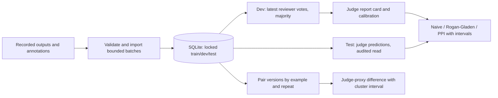

# Getting started

EvalHawk is in development. The offline CLI is usable locally; the demonstration
below makes no model calls and needs no API credentials.

## Prerequisites

- [uv](https://docs.astral.sh/uv/): it installs the right Python (3.12 for development)
  automatically, so your system Python version doesn't matter.
- Git.

## Set up

```bash
git clone https://github.com/evalhawk/evalhawk.git
cd evalhawk
uv sync --all-groups          # creates .venv with the package and all dev tools
uv run pre-commit install     # run the checks automatically on every commit
```

## Everyday commands

| Command | What it does |
|---|---|
| `uv run pytest` | Run the tests (add `-m "not slow"` to skip the long simulations) |
| `uv run ruff check .` | Lint |
| `uv run ruff format .` | Format code, including Python blocks in Markdown |
| `uv run pyright` | Type-check (strict on `core/` and `stats/`) |
| `uv run lint-imports` | Check the architecture's layer rules |
| `uv run zensical serve` | Preview these docs at <http://localhost:8000> |
| `uv run evalhawk --version` | Run the CLI |

!!! tip "Windows"
    If `uv` isn't found in PowerShell, add it to the path for the session:
    `env:Path="env:USERPROFILE\.local\bin;$env:Path"`

## Next

Read the [engineering standards](development/standards.md) before your first pull request.

## Live evaluation

Create a runnable project, then evaluate its tiny support bot:

```bash
uv run evalhawk init my-eval
cd my-eval
uv run evalhawk eval --target-version v1        # runs app.py on data/questions.jsonl
uv run evalhawk eval --target-version v1        # again: resumes, nothing is paid twice
uv run evalhawk judges status --run v1
uv run evalhawk export --run v1 --out results.jsonl
```

The quickstart's checks are **code checks** (`not_empty`, `concise`, `no_personal_data`),
so it runs with no model at all. Even exact checks get honest ranges: 8 of 8 passing is
reported as 100% [67.6%, 100%]. The bot's weak keyword matching makes it fall back to a
reply containing an e-mail address for 4 of 8 questions, and the PII check catches it.

To add **LLM-judged** criteria (`correctness`, `polite`), run a judge model. A free local
one: install [Ollama](https://ollama.com), run `ollama pull qwen3:8b`, then switch the
`criteria = ...` line under `[evaluations.support]` in `evalhawk.toml` to the commented
version that includes them. Any OpenAI-compatible endpoint works: set `base_url`, `model`
and, for hosted APIs, `api_key_env` (the key is read from the environment, never stored).

### What `eval` does

1. Validates the config and the data **before any call**: unknown judges, RAG checks on a
   non-RAG evaluation, or a missing reference answer fail immediately.
2. Locks every question into train/dev/test (before any outcome exists).
3. Calls your app (or reuses the run's answers), then each judge, with limited concurrency,
   retries for rate limits and server errors, timeouts and the `max_cost_usd` budget.
4. Reuses a cached judgment whenever a judge would see exactly the same content (a new
   version with an unchanged answer, or a repeat), so nothing is paid for twice.
5. Prints the **judged** pass rates. To get **corrected** rates, label about 10 PASS and 10
   FAIL answers per LLM criterion (the labelling UI), then run
   `evalhawk report --run v1 --criterion correctness`.

### Label in the browser

```bash
uv sync --extra ui          # or: pip install "evalhawk[ui]"
uv run evalhawk ui          # opens http://127.0.0.1:8765
```

The dashboard lists runs; each run shows every criterion's judged pass rate and whether its
judge is calibrated. **Label** opens one answer at a time: read it, press **P** (pass),
**F** (fail) or **U** (unsure), optionally add a note, and the next answer appears. The
judge's verdict is never shown, so it can't sway you. After about 10 PASS and 10 FAIL
labels, **Report** shows the judge's report card and the corrected pass rates.

### Cheap judge, expensive backup (cascades)

Judge each answer with two judges in one run, label some dev answers, then let EvalHawk
pick how confident the cheap judge must be before its verdict is trusted:

```toml
[judges.small]                       # cheap: must give probabilities
type = "openai_compatible"
base_url = "http://localhost:11434/v1"
model = "qwen3:1.7b"
mode = "verdict_only"                # P(PASS) from logprobs

[evaluations.support]
criteria = { correctness = ["small", "local"] }   # both judges, same answers
```

```bash
uv run evalhawk eval --target-version v1
uv run evalhawk judges cascade --run v1 --criterion correctness --cheap small --strong local --target-accuracy 0.9
```

It prints the risk-coverage table (threshold, share decided by the cheap judge, accuracy
with an interval), the chosen threshold, and **error correlation**: whether the strong
judge is right where the cheap one is wrong. Then use it like any judge:

```toml
[judges.cascade]
type = "cascade"
cheap = "small"
strong = "local"
threshold = 0.95
```

The threshold is chosen on **dev**; confirm the accuracy on test before trusting the saving.

### Compare versions and gate pull requests

```bash
uv run evalhawk eval --target-version v2                       # same dataset, new app version
uv run evalhawk compare --baseline v1 --candidate v2 --db .evalhawk/eval.db --criterion correctness
uv run evalhawk compare ... --corrected                        # remove the judge's bias
uv run evalhawk gate --baseline v1 --candidate v2 --db .evalhawk/eval.db --criterion correctness
```

`--corrected` divides the judged difference by the judge's Youden J (sensitivity +
specificity − 1, measured on dev human labels of both versions), because a lenient or noisy
judge shrinks real differences towards zero. Its interval includes the uncertainty of the
judge's calibration, so it is **wider**: correction removes bias, it cannot add information.
A coverage simulation checks that its 95% intervals contain the true difference ~95% of
the time.

`evalhawk gate` is for CI: exit **0** = no significant regression, **1** = significantly
worse (or, with `--fail-on inconclusive`, not provably as good), **2** = error. A reusable
GitHub Action is in `action.yml`; see `examples/ci/evalhawk-gate.yml`.

### Discover new failure modes

```bash
uv run evalhawk discover --run v1                     # cluster why answers failed
uv run evalhawk discover --run v1 --namer local       # let an LLM judge propose names
```

EvalHawk collects the judge's reasoning on FAIL verdicts and the notes you typed on FAIL
labels, groups similar ones (TF-IDF + k-means, no extra dependencies), and prints each
cluster's key words and examples. With `--namer`, an LLM judge proposes a name and a
yes/no question per cluster; you decide which become new `[[criteria]]`.

### Built-in criteria and code checks

| Built-in template | Needs | Code check | Options |
|---|---|---|---|
| `answer_relevance` | input, output | `exact_match` | `normalise` |
| `correctness` | + reference | `contains`, `not_contains` | `value`, `case_sensitive` |
| `faithfulness` | + contexts (rag) | `regex` | `pattern` |
| `context_relevance` | + contexts (rag) | `max_words`, `min_words`, `max_chars` | `value` |
| `context_recall` | + contexts, reference | `not_empty` | |
| `summary_faithfulness` | input = source | `one_of` | `values`, `normalise` |
| `summary_coverage` | input = source | `valid_json` | |
| `safety_harmful`, `safety_toxic` | output | `json_schema` | `schema` (inline table) |
| `task_completed` | input, output | `field_match` | `field` (dotted path) |
| `instruction_following` | input, output | `pii` | `patterns` (email, phone, card_number) |

Or write your own yes/no question with `question = "..."`, or wrap a Python function as a
judge with `[judges.mine] type = "function"` and `callable = "module:function"`.

## Offline support-bot demo

```bash
uv run evalhawk demo init demo --seed 0
uv run evalhawk import demo/v1.jsonl --target-version v1 --db demo/state.db
uv run evalhawk import demo/v2.jsonl --target-version v2 --db demo/state.db
uv run evalhawk report --run v1 --db demo/state.db --seed 0
uv run evalhawk report --run v2 --db demo/state.db --seed 0
uv run evalhawk report --run v2 --tag billing --db demo/state.db --seed 0
uv run evalhawk compare --baseline v1 --candidate v2 --db demo/state.db --seed 0
uv run evalhawk compare --baseline v1 --candidate v2 --tag billing --db demo/state.db
uv run evalhawk audit --run v1 --db demo/state.db
```

Keep the database and virtual environment outside cloud-synced folders on Windows.
If Windows refuses the generated `evalhawk` executable launcher, use
`uv run python -m evalhawk` in place of `uv run evalhawk` in the commands above.
The default demo contains 1,000 independent support cases, each with three dependent
paraphrases. Labels and outcomes are **simulated**, not actual blind human reviews.
The synthetic judge is lenient; v2 improves shipping/account but regresses on billing.
After viewing the estimates, inspect `demo/answer_key.json` for the true test rates.
Reports and comparisons never read that file. No confidence interval is guaranteed
to contain truth for a particular seed.



### Reading the report

- **Train** remains unused, reserved for tuning. **Dev** calibrates the judge.
  **Test** provides predictions and every outcome read is logged.
- Rate reports choose the smallest example ID, repeat 0, per locked group before
  inspecting outcomes. They estimate this **fixed representative population**, not
  all paraphrases. Cases must be independent and resolved labels representative.
- Per reviewer, latest timestamp wins; equal-time conflicts abstain. UNKNOWN votes
  abstain; majority PASS/FAIL wins; ties are unresolved. Reports show exclusions.
- Rogan-Gladen assumes stable sensitivity/specificity. PPI assumes labelled and
  unlabelled representatives come from the same population. Unknown judgments and
  unresolved labels can introduce selection bias; rates are conditional.
- Comparisons estimate **judge-proxy** changes, not bias-corrected human quality.
  Dependent rows use cluster intervals; IID McNemar and sample planning are omitted.
  Tag intervals are not simultaneous/multiplicity-adjusted.

To exercise independent-pair sample planning, generate another demo with
`--paraphrases 1`, import both files into its own database, and compare with
`--target-effect 0.05`. Planning reports required total and additional pairs for a
five-percentage-point effect at 80% power, subject to IID and discordance assumptions.
It is not a promise that collecting those pairs will prove improvement.

### Import your recorded data

JSONL rows contain `input`, `output`, `judge` (PASS/FAIL/UNKNOWN), optional
`reference`, `group_id`, `tags`, `repeat_index`, and `labels`:

```json
{"input":"Refund request","output":"Approved","judge":"PASS","labels":[{"annotator":"reviewer-a","outcome":"FAIL","created_at":"2026-01-01T00:00:00Z"}]}
```

CSV uses text input/output/judge, pipe-separated tags, and JSON cells for labels,
contexts, metadata, usage and repeat_index. Supply a stable `created_at` for label
history. Non-unit inclusion probabilities are rejected by report adjudication
until weighted inference is implemented. Human labels must be collected without
showing the judge's answer or version identity; file import cannot verify blindness.

Import writes a sibling `.run.json` manifest by default. Repeat the same command to
resume; select `--run-manifest NEW_PATH` for a genuinely new execution. A version
name is not an execution identity: if several executions share it, supply their
exact run ID to report/compare/audit. Criterion, judge and split configuration must
match when resuming or comparing. Imports may leave completed writes if a later
row fails; processed rows are not a count of newly inserted unique records.

Remaining work includes a public human-labelled dataset, DeepEval-format mapping,
live targets/judges, weighted inference and full-population clustered calibration/PPI.
See Proposed ADRs [0011](decisions/0011-offline-report-contract.md) and
[0012](decisions/0012-rich-cli-tables.md).
