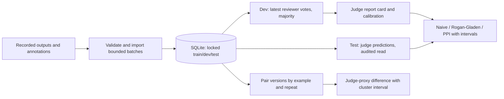

# Getting started

EvalHawk is in development. The offline CLI is usable locally; the demonstration
below makes no model calls and needs no API credentials.

## Prerequisites

- [uv](https://docs.astral.sh/uv/): it installs the right Python (3.12 for development)
  automatically, so your system Python version doesn't matter.
- Git.

## Set up

```bash
git clone https://github.com/evalhawk/evalhawk.git
cd evalhawk
uv sync --all-groups          # creates .venv with the package and all dev tools
uv run pre-commit install     # run the checks automatically on every commit
```

## Everyday commands

| Command | What it does |
|---|---|
| `uv run pytest` | Run the tests (add `-m "not slow"` to skip the long simulations) |
| `uv run ruff check .` | Lint |
| `uv run ruff format .` | Format code, including Python blocks in Markdown |
| `uv run pyright` | Type-check (strict on `core/` and `stats/`) |
| `uv run lint-imports` | Check the architecture's layer rules |
| `uv run zensical serve` | Preview these docs at <http://localhost:8000> |
| `uv run evalhawk --version` | Run the CLI |

!!! tip "Windows"
    If `uv` isn't found in PowerShell, add it to the path for the session:
    `env:Path="env:USERPROFILE\.local\bin;$env:Path"`

## Next

Read the [engineering standards](development/standards.md) before your first pull request.

## Offline support-bot demo

```bash
uv run evalhawk demo init demo --seed 0
uv run evalhawk import demo/v1.jsonl --target-version v1 --db demo/state.db
uv run evalhawk import demo/v2.jsonl --target-version v2 --db demo/state.db
uv run evalhawk report --run v1 --db demo/state.db --seed 0
uv run evalhawk report --run v2 --db demo/state.db --seed 0
uv run evalhawk report --run v2 --tag billing --db demo/state.db --seed 0
uv run evalhawk compare --baseline v1 --candidate v2 --db demo/state.db --seed 0
uv run evalhawk compare --baseline v1 --candidate v2 --tag billing --db demo/state.db
uv run evalhawk audit --run v1 --db demo/state.db
```

Keep the database and virtual environment outside cloud-synced folders on Windows.
If Windows refuses the generated `evalhawk` executable launcher, use
`uv run python -m evalhawk` in place of `uv run evalhawk` in the commands above.
The default demo contains 1,000 independent support cases, each with three dependent
paraphrases. Labels and outcomes are **simulated**, not actual blind human reviews.
The synthetic judge is lenient; v2 improves shipping/account but regresses on billing.
After viewing the estimates, inspect `demo/answer_key.json` for the true test rates.
Reports and comparisons never read that file. No confidence interval is guaranteed
to contain truth for a particular seed.



### Reading the report

- **Train** remains unused, reserved for tuning. **Dev** calibrates the judge.
  **Test** provides predictions and every outcome read is logged.
- Rate reports choose the smallest example ID, repeat 0, per locked group before
  inspecting outcomes. They estimate this **fixed representative population**, not
  all paraphrases. Cases must be independent and resolved labels representative.
- Per reviewer, latest timestamp wins; equal-time conflicts abstain. UNKNOWN votes
  abstain; majority PASS/FAIL wins; ties are unresolved. Reports show exclusions.
- Rogan-Gladen assumes stable sensitivity/specificity. PPI assumes labelled and
  unlabelled representatives come from the same population. Unknown judgments and
  unresolved labels can introduce selection bias; rates are conditional.
- Comparisons estimate **judge-proxy** changes, not bias-corrected human quality.
  Dependent rows use cluster intervals; IID McNemar and sample planning are omitted.
  Tag intervals are not simultaneous/multiplicity-adjusted.

To exercise independent-pair sample planning, generate another demo with
`--paraphrases 1`, import both files into its own database, and compare with
`--target-effect 0.05`. Planning reports required total and additional pairs for a
five-percentage-point effect at 80% power, subject to IID and discordance assumptions.
It is not a promise that collecting those pairs will prove improvement.

### Import your recorded data

JSONL rows contain `input`, `output`, `judge` (PASS/FAIL/UNKNOWN), optional
`reference`, `group_id`, `tags`, `repeat_index`, and `labels`:

```json
{"input":"Refund request","output":"Approved","judge":"PASS","labels":[{"annotator":"reviewer-a","outcome":"FAIL","created_at":"2026-01-01T00:00:00Z"}]}
```

CSV uses text input/output/judge, pipe-separated tags, and JSON cells for labels,
contexts, metadata, usage and repeat_index. Supply a stable `created_at` for label
history. Non-unit inclusion probabilities are rejected by report adjudication
until weighted inference is implemented. Human labels must be collected without
showing the judge's answer or version identity; file import cannot verify blindness.

Import writes a sibling `.run.json` manifest by default. Repeat the same command to
resume; select `--run-manifest NEW_PATH` for a genuinely new execution. A version
name is not an execution identity: if several executions share it, supply their
exact run ID to report/compare/audit. Criterion, judge and split configuration must
match when resuming or comparing. Imports may leave completed writes if a later
row fails; processed rows are not a count of newly inserted unique records.

Remaining work includes a public human-labelled dataset, DeepEval-format mapping,
live targets/judges, weighted inference and full-population clustered calibration/PPI.
See Proposed ADRs [0011](decisions/0011-offline-report-contract.md) and
[0012](decisions/0012-rich-cli-tables.md).